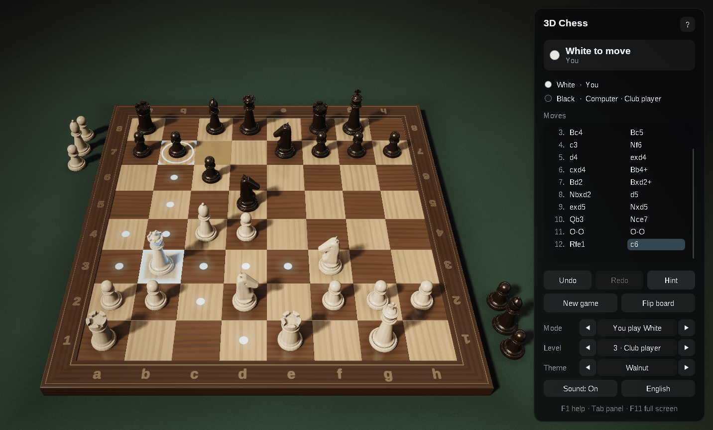
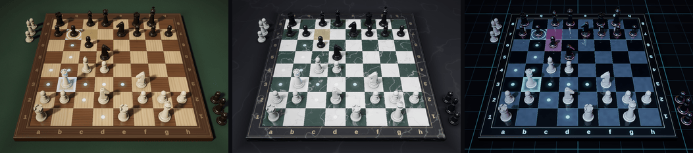

# 3D Chess — C++23, Win32 and OpenGL 4.6

[](https://github.com/sponsors/makarov-mm)
[](LICENSE)


[](https://www.linkedin.com/in/makarov-mm/)
[](https://www.threads.net/@m.m.makarov)
[](https://www.instagram.com/m.m.makarov/)

A 3D chess game for Windows written in modern C++ on plain Win32 and OpenGL 4.6.

There is no game engine, framework or third-party library, and no model, texture or sound file: the chess pieces are modeled in code and meshed at startup, the materials are procedural, the lighting environment is baked on the GPU, and the sounds are synthesized. The shaders are built into the executable, so the game is a single `.exe`.





## Features

### Graphics

- Physically based shading: GGX highlights, a clear lacquer coat, soft light inside the pieces, image-based lighting from a procedural studio environment (irradiance, prefiltered reflections and the BRDF table are baked with compute shaders)
- Soft shadows (PCSS) and contact shadows under the pieces
- The pieces reflected in the polished board
- HDR rendering with 4× MSAA, bloom, ACES tone mapping, vignette and dithering
- Procedural materials: wood grain, marble, turned metal, neon acrylic
- Staunton-style pieces modeled with signed distance functions and meshed at startup (about 480,000 triangles), with a lighter version for the shadows and reflections
- Three themes: Walnut, Marble and Neon
- Animation: the pieces glide and hop, knights turn to where they go, captured pieces fly to the table, promoted pieces and new games dissolve in
- An interface of frosted-glass panels, sharp at any screen scale

### Play

- All the rules: castling, en passant, promotion to any piece, check, checkmate, stalemate, draws by threefold repetition, by the fifty-move rule and for lack of material
- A computer opponent with five levels, from Beginner to Master. It searches with iterative deepening, principal variation search, a transposition table, null-move pruning, late move reductions, killer and history heuristics and a quiescence search, and evaluates with tapered piece-square tables, the bishop pair, pawn structure and passed pawns, rooks on open files and the king's pawn shield. The lower levels search less deeply and now and then choose a weaker move. It thinks in the background, so the window stays responsive
- Play White, play Black, two players on one computer, or watch the computer play itself
- Move by clicking or by dragging the pieces; the legal moves, captures, the last move and check are highlighted
- Undo and redo, the move list in algebraic notation, the material balance
- Hints: an arrow shows a suggested move
- Copy the game as PGN or the position as FEN, and paste a PGN game or a FEN position to continue from it
- The game in progress and the settings are kept between sessions
- English and Russian interface, chosen from the system language
- Sound effects, full screen, per-monitor DPI awareness, a dark title bar
- No work while nothing moves: the game waits for input instead of drawing the same picture

## Controls

| Action | Control |
|---|---|
| Move a piece | Click it, then a square — or drag it |
| Turn the view | Right drag, or drag beside the pieces |
| Zoom | Mouse wheel |
| Take back / replay a move | `Ctrl+Z` / `Ctrl+Y`, `←` / `→`, `Backspace` |
| Hint | `H` |
| New game | `N` |
| Flip the board | `F` |
| View from above | `V` |
| Reset the view | `Home` |
| Computer level | `1` … `5` |
| Who plays whom | `M` |
| Next theme | `T` (`Shift+T` back) |
| Sound on / off | `S` |
| English / Russian | `L` |
| Show / hide the panel | `Tab` |
| Full screen | `F11`, `Alt+Enter` |
| Copy the game (PGN) / position (FEN) | `Ctrl+C` / `Ctrl+Shift+C` |
| Paste a PGN game or a FEN position | `Ctrl+V` |
| Promotion | `Q`, `R`, `B`, `N` |
| Help | `F1` |
| Leave full screen, deselect | `Esc` |

## Requirements

- Windows 10 (version 1703 or later) or Windows 11, x64
- A graphics card and driver with OpenGL 4.6 (4.5 is enough)
- Visual Studio 2026 with the **Desktop development with C++** workload; the project uses the C++23 language standard (`/std:c++23`, or `/std:c++23preview` with MSVC Build Tools older than 14.52)

## Building and running

Open `Chess3D.slnx` in Visual Studio, choose the **Release | x64** configuration and run the project (`Ctrl+F5`).

From a Developer PowerShell:

```powershell
msbuild Chess3D.slnx -p:Configuration=Release -p:Platform=x64
.\bin\x64\Release\Chess3D.exe
```

The Release build links the C++ runtime statically, so `Chess3D.exe` runs on its own. The settings and the game in progress are kept in `%APPDATA%\Chess3D\Chess3D.ini`.

## Project structure

```text
.
├── assets/                Chess3D.ico
├── shaders/               GLSL shaders, built into the executable as resources
├── src/
│   ├── Main.cpp           entry point
│   ├── App.*              the window, game flow, input and interface
│   ├── Chess.*            rules: positions, move generation, SAN, FEN and PGN, the game record
│   ├── Engine.*           the computer player: search and evaluation
│   ├── PieceModels.*      the pieces as signed distance functions, and their meshing
│   ├── BoardGeometry.*    meshes of the board, its frame, the table and the hint arrow
│   ├── BoardView.*        the pieces on the board and their animation
│   ├── Camera.*           orbit camera and mouse rays
│   ├── Renderer.*         the rendering pipeline
│   ├── Themes.*           materials and lighting of the themes
│   ├── Gl.*               OpenGL context (WGL) and functions
│   ├── Text.*             font atlases rendered with GDI
│   ├── UiPainter.*        drawing of the interface
│   ├── Sound.*            synthesized sound effects
│   ├── Settings.*         the settings file
│   ├── Strings.*          English and Russian texts
│   ├── Resources.*        access to the resources built into the executable
│   ├── MathTypes.h        vectors and matrices
│   └── Win32.h            windows.h and UTF-8 conversions
├── Chess3D.rc             the icon, version information and shaders
├── Chess3D.vcxproj
└── Chess3D.slnx
```

## How a frame is drawn

1. **Shadow map** — the pieces seen from the key light, for soft shadows.
2. **Reflection** — the pieces mirrored under the board, drawn at half resolution and blurred into mipmaps, so the polish of each theme can show a sharper or softer reflection.
3. **Main pass** — the table, the board and the pieces in HDR with 4× MSAA, lit by the key light and the baked environment; the background is the environment itself.
4. **Post-processing** — the samples are resolved, bright parts spread into a six-level bloom, and the composite pass applies tone mapping and vignetting and frosts the glass behind the interface panels.
5. **Interface** — panels, text and icons, drawn on top.

The environment maps are baked with compute shaders when the theme changes, and the BRDF table once at startup.

## License

MIT License

Copyright (c) 2026 Mykhailo Makarov

Permission is hereby granted, free of charge, to any person obtaining a copy
of this software and associated documentation files (the "Software"), to deal
in the Software without restriction, including without limitation the rights
to use, copy, modify, merge, publish, distribute, sublicense, and/or sell
copies of the Software, and to permit persons to whom the Software is
furnished to do so, subject to the following conditions:

The above copyright notice and this permission notice shall be included in all
copies or substantial portions of the Software.

THE SOFTWARE IS PROVIDED "AS IS", WITHOUT WARRANTY OF ANY KIND, EXPRESS OR
IMPLIED, INCLUDING BUT NOT LIMITED TO THE WARRANTIES OF MERCHANTABILITY,
FITNESS FOR A PARTICULAR PURPOSE AND NONINFRINGEMENT. IN NO EVENT SHALL THE
AUTHORS OR COPYRIGHT HOLDERS BE LIABLE FOR ANY CLAIM, DAMAGES OR OTHER
LIABILITY, WHETHER IN AN ACTION OF CONTRACT, TORT OR OTHERWISE, ARISING FROM,
OUT OF OR IN CONNECTION WITH THE SOFTWARE OR THE USE OR OTHER DEALINGS IN THE
SOFTWARE.

## Support

If you found this project interesting or useful, you can support my work:

[](https://github.com/sponsors/makarov-mm)
